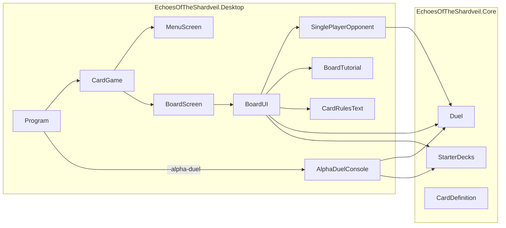
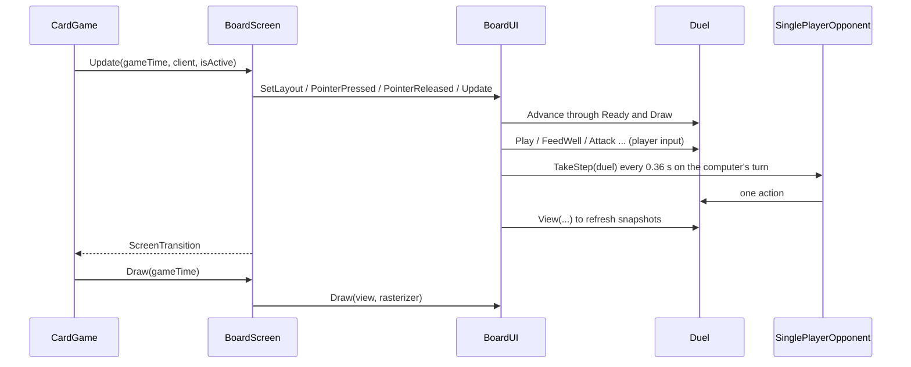

❰ [Making of alpha.02](../README.md) ❬ Architecture

# Architecture

| CONTENTS |
|:--|
| [Solution layout](#solution-layout) |
| [Core: the rules engine](#core-the-rules-engine) |
| [Desktop: one game, several screens](#desktop-one-game-several-screens) |
| [How a frame flows](#how-a-frame-flows) |
| [The computer opponent](#the-computer-opponent) |
| [The console hot-seat mode](#the-console-hot-seat-mode) |
| [Platform helpers](#platform-helpers) |
| [File map](#file-map) |

## Solution layout

```text
src/
|-- Directory.Build.props            Shared settings for both projects
|-- global.json                      Pins the .NET SDK
|-- EchoesOfTheShardveil.slnx        Solution
|-- EchoesOfTheShardveil.Core/       Rules engine (no MonoGame reference)
|-- EchoesOfTheShardveil.Desktop/    MonoGame app, references Core
    |-- Content/                     Art, font sheets and music, embedded into the executable
```

The split was there from the first code commit and has held up: **Core knows nothing about graphics or input**, and Desktop never changes duel state except through Core's public methods. A code review in this project called this the strongest part of the codebase.



## Core: the rules engine

Four files, about 700 lines.

| File | Contents |
|:--|:--|
| `CardDefinition.cs` | The immutable `CardDefinition` record (id, name, type, cost, power, health, subtype, aspect, keywords, abilities), the `CardType`, `CardKeyword` (a flags enum) and ability enums, and the `CardAbility` record. |
| `DuelState.cs` | The phase and outcome enums, plus read-only views: `UnitTarget`, `CardPlay`, `UnitView`, `PlayerView`, `AttackView`. |
| `Duel.cs` | The `Duel` class: all state and every rule. |
| `StarterDecks.cs` | The 14-card test pool and the two 40-card decks. |

### The `Duel` API

`Duel` is a single mutable object that owns two private `Player` records. Players are addressed by index (0 or 1). Every action method checks the phase, the acting player, and legality, and throws `InvalidOperationException` (or `ArgumentException` for a bad deck) with a player-readable message if the action is not allowed.

| Method | Purpose |
|:--|:--|
| `new Duel(deckOne, deckTwo, seed?)` | Validate decks, choose the first player, shuffle, deal. |
| `View(player, viewer)` | A snapshot of one side. Only the viewer's own hand is included, so hidden information never leaves the engine. |
| `Mulligan(player, handSlots)` | The once-per-duel hand exchange. |
| `Advance(player)` | Resolve the current phase and move to the next. |
| `FeedWell`, `UseSpark` | Energy actions in Main. |
| `LegalPlays(player, handSlot)` | Every legal slot and target for a hand card, without changing state. |
| `Play(player, handSlot, target?, boardSlot?)` | Pay for and play a card. |
| `Activate(...)` | Use an activated ability (unused by current cards). |
| `Attack(player, attackerSlot, target?)` | Declare an attack. A null target means the Leader. |
| `Defend(player, interceptSlot?)` | Take the attack or intercept, then resolve combat. |
| `DiscardToLimit(player, handSlot)` | Discard down to 10 in End. |

Properties expose `Phase`, `Outcome`, `ActivePlayer`, `Turn` and `PendingAttack`.

Design choices worth knowing:

* **Abilities are data.** Effects are interpreted from `CardAbility` records in `ResolveAbilities`, so a new card that reuses existing triggers, targets and actions needs no code.
* **Deterministic when seeded.** All randomness (first player, shuffles, mulligan order, random targets) comes from one `Random`, so a seed replays a duel exactly.
* **Snapshots, not live objects.** The UI and AI only see `PlayerView` and `UnitView` records. They can't accidentally mutate state.
* **Cleanup is simultaneous.** All lethal Units are removed before any Last Breath resolves, and the loop repeats until nothing else dies.

## Desktop: one game, several screens

Early builds ran two MonoGame `Game` instances one after another: the menu, then a separate board game. That restarted the window and the music. In the alpha.02 commit this became **one `CardGame`** (the only `Game`) that switches between **screens**.

* `IScreen` (in `IScreen.cs`) is a full-window state with `Update`, `Draw`, `RequestClose` and a window `Title`. `Update` returns a `ScreenTransition`: `None`, `OpenBoard`, `ReturnToMenu` or `ExitGame`.
* `GameServices` is a record of what the host owns and shares: the `GraphicsDevice`, `SpriteBatch`, a 1x1 white pixel texture, the bitmap font, and `GameAudio`.
* `CardGame` loads the shared resources, creates the `MenuScreen` once, creates a fresh `BoardScreen` for each duel and disposes it on return, and starts the music once so it plays across screens.
* All assets are **embedded resources** opened through `CardGame.OpenEmbeddedAsset(name)`. There is no MonoGame content pipeline and no `Content` folder at run time.

### Closing the window

`CardGame.OnExiting` decides what a close request means:

* If `QuitWatcher` reports an **application quit** (macOS menu-bar Quit or Cmd+Q), the game exits at once.
* Otherwise (the window's close button), the exit is cancelled and the current screen shows its prompt: "Exit Echoes of the Shardveil?" on the menu, "Forfeit the game?" on the board.
* Once the player confirms Exit on the menu, `exitConfirmed` is set and the game really exits.

See [tooling](../tooling/README.md#macos-quit-handling) for how `QuitWatcher` tells the two apart.

## How a frame flows



`BoardScreen` turns raw mouse and keyboard state into edge events (press, release, right-click, scroll, Escape) and maps window coordinates into board coordinates with `BoardViewport`. `BoardUI` owns the `Duel`, the tutorial, drag state and the inspector, and draws everything. See [ui](../ui/README.md).

## The computer opponent

`SinglePlayerOpponent.TakeStep` performs **one** legal action per call, and `BoardUI` calls it every 0.36 seconds so the player can follow along. Its rules, in order:

1. If you attacked, intercept with its first Unit that can, otherwise take the hit.
2. In Main, feed the Well with its most expensive card, as long as it holds more than one card.
3. Then play the most expensive card it can afford (using Spark if that makes the difference), picking the first available target.
4. In Battle, attack your Hero with its first Unit that can attack.
5. In End, discard its last card while over the hand limit.
6. Otherwise, advance the phase.

It returns a short message ("Opponent played Spark Bolt.") that the board shows in its status line. It always keeps its opening hand.

## The console hot-seat mode

Running the app with `--alpha-duel` skips MonoGame entirely and starts `AlphaDuelConsole`: a text duel for two players on one keyboard, with "pass control" prompts between turns so each player only sees their own hand. Commands include `well`, `spark`, `play`, `attack`, `take`, `intercept`, `discard`, `next` and `quit`. It is the quickest way to playtest rule changes.

## Platform helpers

| File | Purpose |
|:--|:--|
| `DesktopDrawable.cs` | Asks SDL for the real drawable and window sizes and resizes the back buffer to match, so the game is sharp on high-DPI (Retina) displays and mouse positions map correctly. |
| `QuitWatcher.cs` | Watches SDL events to tell an application quit from a window close. |
| `ScreenLayout.cs` | Fit, cover and overlay rectangles for the menu artwork, and mouse mapping. |
| `BoardViewport.cs` | Scales the 1280 x 720 board uniformly and lets it grow on whichever axis has spare room. |
| `CircleTexture.cs` | Builds antialiased round textures: framed portraits, the drop ring, a blank badge. |
| `BitmapText.cs` | Draws ASCII text from the `Board-Font.png` glyph sheet. |
| `WindowControls.cs` | The exit and sound icons in the upper right and the modal confirmation dialog. |
| `GameAudio.cs` | Loads and loops the theme, honors the sound toggle, and survives machines with no audio hardware. |

## File map

| File | Lines | Role |
|:--|--:|:--|
| Core/`Duel.cs` | 593 | Rules engine |
| Core/`StarterDecks.cs` | 57 | Test card pool and decks |
| Core/`CardDefinition.cs` | 36 | Card data model |
| Core/`DuelState.cs` | 22 | Phases, outcomes, views |
| Desktop/`BoardUI.cs` | 1,343 | Board layout, input handling and drawing |
| Desktop/`MuralEffects.cs` | 703 | Main menu mural animation |
| Desktop/`SideSceneEffects.cs` | 485 | Ultrawide side-scene animation |
| Desktop/`WindowControls.cs` | 206 | Exit and sound controls, confirmation dialog |
| Desktop/`AlphaDuelConsole.cs` | 187 | Console hot-seat mode |
| Desktop/`BoardScreen.cs` | 176 | Board screen: assets and input |
| Desktop/`MainUI.cs` | 158 | Main menu layout and drawing |
| Desktop/`TitleReveal.cs` | 124 | Title burn-in drawing |
| Desktop/`CardGame.cs` | 123 | The game host |
| Desktop/`MenuScreen.cs` | 119 | Menu screen: assets and input |
| Desktop/`BoardTutorial.cs` | 113 | Tutorial pages |
| Desktop/`SinglePlayerOpponent.cs` | 101 | Computer opponent |
| Desktop/`GameAudio.cs` | 85 | Music |
| Desktop/`QuitWatcher.cs` | 84 | macOS quit detection |
| Desktop/`DesktopDrawable.cs` | 81 | High-DPI back buffer sync |
| Desktop/`CardRulesText.cs` | 65 | Rules text for the inspector |
| Desktop/`TitleBurn.cs` | 62 | Title burn-in math |
| Desktop/`CircleTexture.cs` | 62 | Round textures |
| Desktop/`ScreenLayout.cs` | 52 | Menu layout helpers |
| Desktop/`BoardViewport.cs` | 37 | Board scaling |
| Desktop/`BitmapText.cs` | 26 | Bitmap text |
| Desktop/`IScreen.cs` | 25 | Screen contract |
| Desktop/`Program.cs` | 10 | Entry point |

***

❰ [Making of alpha.02](../README.md) ❬ Architecture
